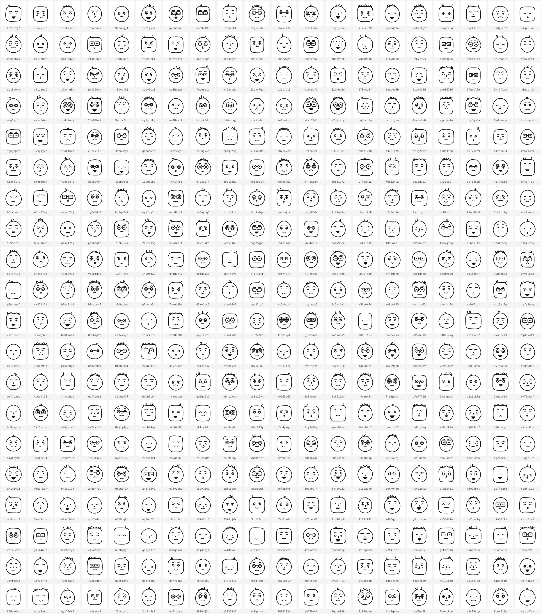

# trombine

Deterministic avatar SVGs from a seed string. Same seed, same avatar, on every runtime
(browser, Node, Deno, Cloudflare Workers).



| Package | What |
| --- | --- |
| [`@trombine/core`](packages/core) | `seed -> SVG string`, themes. Zero runtime dependencies, no Node/DOM APIs. |
| [`@trombine/server`](packages/server) | Hono app for Node and Cloudflare Workers. |
| [`trombine`](packages/cli) | CLI. |

## Library

```ts
import { createAvatar } from '@trombine/core';

const svg = createAvatar('alice'); // theme "doodle", 256x256
const small = createAvatar('alice', { theme: 'doodle', size: 64 });
const yellow = createAvatar('alice', { bg: 'ffcc00' }); // custom background, "#ffcc00" works too
```

Themes: `doodle` (default), also available as `classik`.

Output is a standalone SVG with `viewBox="0 0 100 100"` and `width`/`height` set to `size`.
Unknown theme, non-positive-integer size or a `bg` that is not 6 hex digits throws.

## CLI

```bash
npx trombine alice --theme doodle --size 256 --bg ffcc00 > alice.svg
```

From this repo: `node packages/cli/dist/index.js alice > alice.svg`.

## Server

```
GET /explorer          web playground: themes, demos, live preview and the call URLs
GET /:seed.svg?theme=doodle&size=256&bg=ffcc00
GET /:seed.png?theme=doodle&size=256&bg=ffcc00   (Node only, 501 on Workers)
```

Responses carry `Cache-Control: public, max-age=31536000, immutable`. `size` must be an integer
from 16 to 1024, seeds are capped at 256 characters, `bg` (optional) is 6 hex digits without `#`;
anything else is a 400.

```bash
pnpm build && pnpm --filter @trombine/server start   # Node, PORT defaults to 3000
cd packages/server && npx wrangler deploy             # Cloudflare Workers (src/worker.ts)
```

## Development

```bash
pnpm install
pnpm build
pnpm test
pnpm contact-sheet [count=400] [out=docs/doodle-preview.png] [theme=doodle]
```

The contact sheet renders random seeds in a grid with the seed under each face, to spot ugly
combinations. Needs Node 23.6+ (runs the `.ts` file directly).

## How randomness works

The seed is hashed with cyrb53 and fed to mulberry32. `Math.random` is never used in core
(a test enforces it). Every slot draws from its own sub-stream, `rng.fork('eyes')`, which is
seeded from `hash(seed + ":eyes")`. Adding a slot, or drawing more numbers in one slot, never
changes what the other slots draw.

The `Rng` helper has `float(min, max)`, `int(min, max)` (inclusive), `pick(arr)`, `chance(p)`,
`weighted([[item, weight], ...])` and `fork(name)`.

## Writing a theme

A theme is an object with a name, a viewBox size and a `render` function that returns the
inner SVG markup:

```ts
import type { Theme } from '@trombine/core';

export const blob: Theme = {
  name: 'blob',
  viewBox: 100,
  render(rng, opts) {
    const face = rng.fork('face');
    const eyes = rng.fork('eyes');
    const hue = face.int(0, 359);
    const r = face.float(30, 40);
    const gap = eyes.float(8, 14);
    return (
      `<rect width="100" height="100" fill="${opts.background ?? `hsl(${hue} 60% 90%)`}"/>` +
      `<circle cx="50" cy="50" r="${r.toFixed(2)}" fill="hsl(${hue} 60% 60%)"/>` +
      `<circle cx="${50 - gap}" cy="45" r="3"/><circle cx="${50 + gap}" cy="45" r="3"/>`
    );
  },
};
```

Rules of thumb:

- **Honor `opts.background`** when set (`#rrggbb`, already validated), else use your own default.
- **One fork per slot.** Never draw from the root `rng` directly, and never rename a slot,
  or every existing avatar changes.
- **Derive dependent parts, don't re-roll them.** In `doodle`, glasses take the eye positions
  as input, so they always enclose the eyes. Pass slot results forward instead of guessing.
- **Round your numbers** (see `pt()` in [`themes/doodle/util.ts`](packages/core/src/themes/doodle/util.ts))
  to keep output short and identical across engines.
- **Stay inside the viewBox.** The test suite checks every path, circle and rect of 1000 seeds.
  Use absolute path commands only (`M L Q C Z`) so the check can read them.

Register it in `themes` in [`packages/core/src/index.ts`](packages/core/src/index.ts), one file
per slot under `packages/core/src/themes/<name>/`, and add it to the snapshot test. Once a theme
ships, a snapshot diff means existing avatars changed: treat it as a breaking change, not
something to `-u` away.
